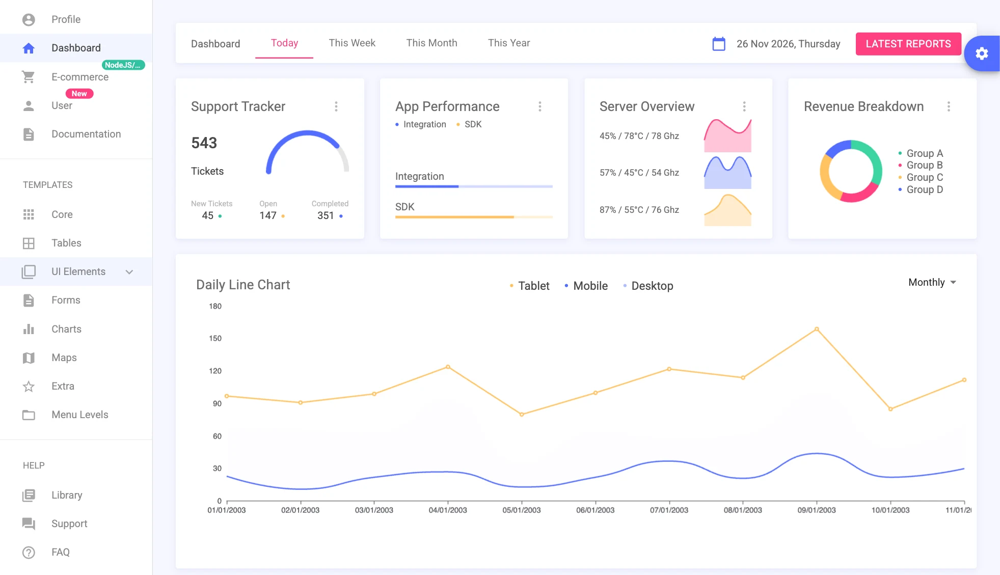

# Angular Material Admin Full

An Angular 21 dashboard template by Flatlogic. Start with a working admin interface for managing users, browsing products and charting activity. The template includes Angular Material forms and tables, Apache ECharts examples and a calendar.

[Live demo](https://demo.flatlogic.com/angular-material-admin-full/) · [Download a release](https://github.com/flatlogic/angular-material-admin-full/releases/latest) · [Changelog](changelog.md) · [MIT license](LICENSE)

[](https://demo.flatlogic.com/angular-material-admin-full/)

## Run locally

Use Node.js 22.12 or newer within the 22.x line and npm 10. If you use nvm, run `nvm install` in the repository to select the version from [.nvmrc](.nvmrc).

```sh
git clone https://github.com/flatlogic/angular-material-admin-full.git
cd angular-material-admin-full
npm ci --legacy-peer-deps
npm start
```

Open [localhost:3000](http://localhost:3000/) and select **Login** with the prefilled demo account. To try user management, open [the local user list](http://localhost:3000/admin/users), select **New**, create a sample user, then edit their name and refresh. In this mode, user changes stay in your browser.

## Choose where user data lives

| Command | Sign-in and user management |
| --- | --- |
| `npm start` | Uses mock sign-in and a user list stored in the browser. Use this mode to explore the UI locally. |
| `npm run start:backend` | Runs the UI locally against Flatlogic’s shared demo API. The hosted demo uses the same API. |

The shared demo resets to its sample data every hour. With the API connected, creating a user starts an email invitation. Editing a name or role preserves the user's password. User responses omit password hashes and verification or reset tokens. See the [hosted API reference](https://sing-generator-node.flatlogic.com/api-docs/).

To point the app at your own compatible backend, set the API host and port in [app.config.ts](src/app/app.config.ts). The [Angular environments](src/environments) select mock or API-backed behavior.

## Explore the template

| Area | What you can try |
| --- | --- |
| Dashboard and charts | Explore the dashboard widgets and the line, bar and pie chart examples. |
| User management | Filter users, create a user, edit profile details and assign roles. |
| E-commerce | Browse the product grid, inspect a product and open the product editor. |
| Calendar and page layouts | Browse calendar events, invoices and gallery layouts. |
| Forms, tables and maps | Try form validation, dynamic tables, Material components and map views. |

## Build and test

```sh
npm run lint
npm run typecheck
npm test
npx playwright install chromium
npm run e2e
```

The Playwright suite starts its own local server. See the [CI workflow](.github/workflows/ci.yml) for the Linux runner setup.

Run `npm run build` for a site hosted at the domain root. The public demo uses a subdirectory and needs this base path.

```sh
npm run build -- --base-href /angular-material-admin-full/
```

Serve the contents of `build/` at that path. Configure the host to serve `index.html` for Angular page routes so a refresh or a bookmarked link opens the right page. The production build uses the hosted API by default.

## More from Flatlogic

<details>
<summary>Related dashboard templates and example apps</summary>

| Framework | Templates |
| --- | --- |
| Angular | [Light Blue](https://github.com/flatlogic/light-blue-angular) · [Sing App](https://github.com/flatlogic/sing-app-angular) |
| React | [Material Admin](https://github.com/flatlogic/react-material-admin) · [Light Blue](https://github.com/flatlogic/light-blue-react) · [Sing App](https://github.com/flatlogic/sing-app-react) · [Sofia](https://github.com/flatlogic/sofia-react) · [One](https://github.com/flatlogic/one-react) |
| Vue | [Material Admin](https://github.com/flatlogic/material-vue-full) · [Light Blue](https://github.com/flatlogic/light-blue-vue) · [Sing App](https://github.com/flatlogic/sing-app-vue-dashboard) |
| Bootstrap | [Light Blue](https://github.com/flatlogic/light-blue-html5) · [Sing App](https://github.com/flatlogic/sing-app-html5) · [One](https://github.com/flatlogic/one-bootstrap-template-full) |

Explore the [e-commerce storefront](https://github.com/flatlogic/ecommerce-frontend), [Bookkeeper accounting app](https://github.com/flatlogic/bookkeeper) and [user management template](https://github.com/flatlogic/user-management-template).

</details>

Browse the [template catalog](https://flatlogic.com/templates) or start a new app with the [Flatlogic generator](https://flatlogic.com/generator). For help, visit the [support forum](https://flatlogic.com/forum). To report a bug, [open an issue](https://github.com/flatlogic/angular-material-admin-full/issues) with the steps to reproduce it.

## License

Released under the [MIT license](LICENSE).
